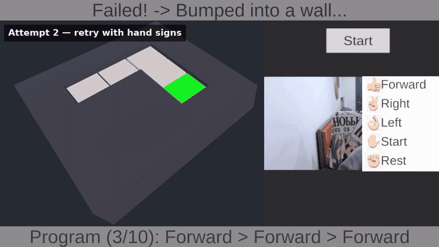

# AR Sign Language Learning Game (Prototype)

A game-based learning prototype where players program a robot using hand signs instead of a keyboard.
Built in Unity with MediaPipe hand tracking from a regular webcam (no headset required).

## How it works

Webcam → MediaPipe Hands (21 landmarks) → Normalize → Rule-based sign classifier → Hold-to-confirm → Command queue → Robot on a grid puzzle

| Sign | Command |
|---|---|
| 👍 | Forward |
| 👌 | Turn left |
| ✌️ | Turn right |
| ✋ | Start (run program) |
| ✊ | Rest (re-arm) |

## Highlights

- **Normalization:** landmarks are made position-, scale- and handedness-independent.
- **Hold-to-confirm:** a sign must be held for 0.5 s; brief misreads are tolerated, and a different sign restarts the timer, so passing through intermediate handshapes never triggers a command.
- **Decoupled input:** the game only receives command strings, so the keyboard and hand signs share one entry point.

## Limitations

- Current gestures are placeholder handshapes, **not verified Thai Sign Language signs**.
- Static handshapes only: no movement, location, palm orientation or facial expressions.
- Runs on PC with a webcam; the game board is not yet anchored in the real world.

## Next steps

- Choose vocabulary together with Deaf signers / TSL teachers.
- Use MediaPipe Holistic and a sequence model for signs with movement.
- Port to mobile AR with AR Foundation (board placed on a real table).

## Tech

Unity 6.3 · C# · [MediaPipe Unity Plugin](https://github.com/homuler/MediaPipeUnityPlugin) v0.16.3